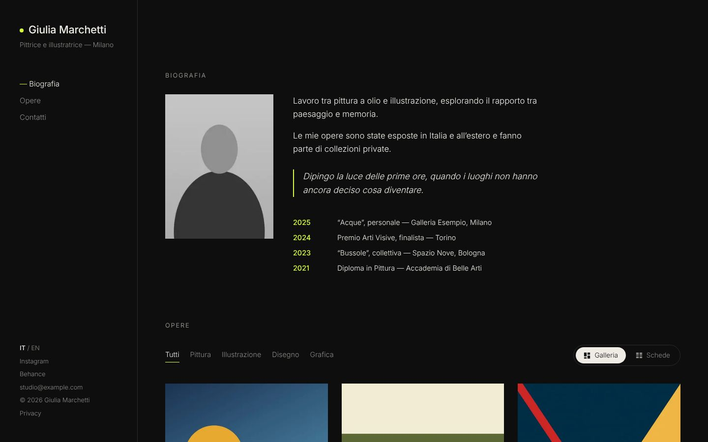
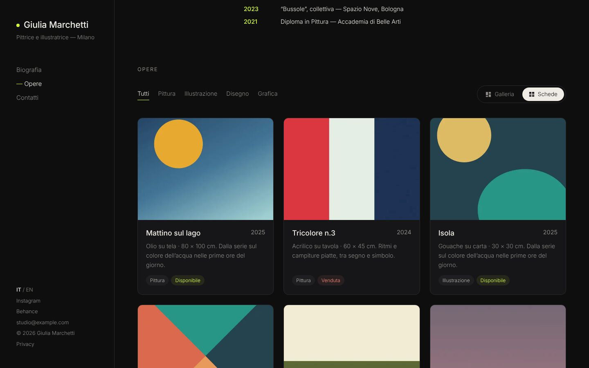
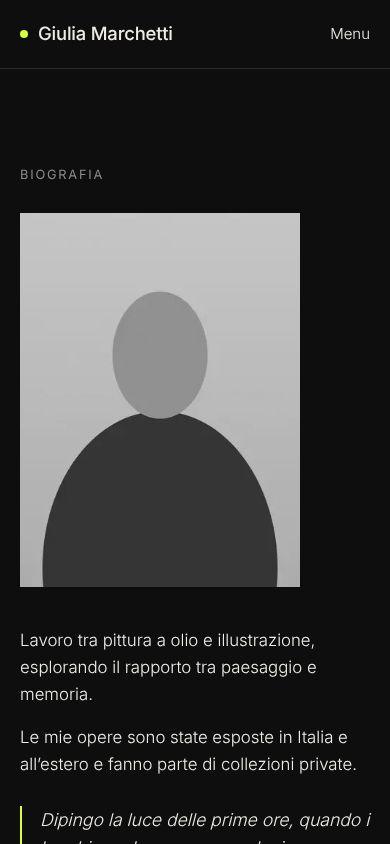

# Portfolio Artist

Sito portfolio **generico e personalizzabile** per artisti professionisti, con un **pannello di amministrazione semplice** da cui l'artista gestisce biografia, opere, categorie e messaggi senza competenze tecniche. Un'installazione = un artista, distribuita con **Docker**.



| Galleria | Schede | Lightbox |
|---|---|---|
|  |  |  |

| Pannello: benvenuto | Pannello: modifica di un'opera | Mobile |
|---|---|---|
|  |  |  |

## Cosa offre

- **Sito one-page** (Biografia → Opere → Contatti) con il tema *Atelier Notturno*: sidebar fissa, filtri per categoria, vista Galleria o Schede, lightbox con tastiera e swipe, pagina dedicata per ogni opera.
- **Italiano e inglese**: contenuti traducibili dal pannello, URL `/it/…` e `/en/…`, lingua scelta in base al browser.
- **Pannello in italiano** (Payload CMS su `/admin`): pulsanti grandi per le azioni frequenti, caricamento di più immagini insieme, ordinamento con drag & drop, bozze e anteprima, messaggi dal form contatti.
- **Personalizzazione** da *Impostazioni del sito*: colore principale, caratteri, logo, icona, vista predefinita delle opere, prezzi, modulo contatti, testi SEO, privacy, statistiche senza cookie (Plausible/Umami).
- **SEO**: metadata e Open Graph per pagina, `hreflang`, sitemap multilingua, `robots.txt`, dati strutturati `Person` e `VisualArtwork`. Lighthouse mobile ≥ 95 in tutte le categorie con i dati demo.
- **Produzione**: immagine Docker standalone non-root, migrazioni automatiche all'avvio, backup giornalieri di database e immagini, header di sicurezza. Il TLS resta al tuo reverse proxy.

## Avvio rapido (sviluppo)

Servono Node 24, pnpm (via `corepack enable`) e Docker (oppure PostgreSQL locale).

```bash
pnpm install
cp .env.example .env        # imposta PAYLOAD_SECRET (openssl rand -hex 32)
./scripts/dev-db.sh         # avvia PostgreSQL e crea i database portfolio e portfolio_test
pnpm seed                   # migrazioni + dati demo (imposta SEED_ADMIN_EMAIL/PASSWORD per un utente demo)
pnpm dev                    # http://localhost:3000 e http://localhost:3000/admin
```

Senza `SEED_ADMIN_*` il primo accesso a `/admin` chiede di creare l'utente.

Verifiche:

```bash
pnpm lint && pnpm typecheck && pnpm test   # unit + integrazione (DB di test)
pnpm test:e2e                              # Playwright su build di produzione
```

## Deploy in 5 passi

Su un server con Docker e un reverse proxy che gestisce HTTPS (dettagli ed esempi in [docs/DEPLOY.md](docs/DEPLOY.md)):

1. Copia sul server `compose.prod.yml`, la cartella `docker/backup/` e la cartella `scripts/` (oppure clona il repository).
2. Genera la configurazione: `./scripts/setup.sh` (chiede l'indirizzo pubblico e la porta locale, crea `.env` con segreti casuali).
3. Avvia: `docker compose -f compose.prod.yml up -d` (usa l'immagine `ghcr.io/ruy41321/portfolio-artist`; aggiungi `--build` per costruirla dal sorgente).
4. Configura il reverse proxy verso `http://127.0.0.1:APP_PORT` (esempi per nginx, Caddy e Traefik in DEPLOY.md).
5. Apri `https://tuo-dominio/admin`, crea l'utente dell'artista e consegna la [guida per l'artista](docs/GUIDA-ARTISTA.md).

## Configurazione

Tutte le variabili sono documentate in [`.env.example`](.env.example). Le principali:

| Variabile | Descrizione |
|---|---|
| `NEXT_PUBLIC_SERVER_URL` | Indirizzo pubblico del sito, senza `/` finale (URL assoluti, sitemap, Open Graph, CSRF). Letto all'avvio: la stessa immagine va bene per qualsiasi dominio. |
| `PAYLOAD_SECRET` | Segreto lungo e casuale per le sessioni. |
| `DATABASE_URL` / `POSTGRES_*` | Connessione a PostgreSQL (in produzione composta da `POSTGRES_*`). |
| `APP_PORT`, `APP_BIND` | Porta e interfaccia su cui l'app ascolta (default `127.0.0.1:3000`). |
| `MAX_UPLOAD_MB` | Dimensione massima dei file caricati. |
| `SMTP_*`, `CONTACT_EMAIL_TO` | Email facoltativa per il form contatti; senza SMTP i messaggi restano nel pannello. |
| `BACKUP_INTERVAL_HOURS`, `BACKUP_RETENTION_DAYS`, `BACKUP_DIR` | Frequenza, durata e cartella dei backup. |

## Aggiornamento

```bash
docker compose -f compose.prod.yml pull
docker compose -f compose.prod.yml up -d
```

Le migrazioni del database vengono applicate automaticamente all'avvio. Prima di aggiornare conviene fare un backup: `./scripts/backup.sh`.

## Documentazione

- [docs/DEPLOY.md](docs/DEPLOY.md) — installazione su server, reverse proxy, Aruba, backup e ripristino, risoluzione problemi
- [docs/GUIDA-ARTISTA.md](docs/GUIDA-ARTISTA.md) — guida al pannello per l'artista
- [docs/CUSTOMIZZAZIONE.md](docs/CUSTOMIZZAZIONE.md) — nuovi temi, nuovi campi, nuove lingue
- [docs/PLAN.md](docs/PLAN.md) e [docs/PROGRESS.md](docs/PROGRESS.md) — piano e diario di sviluppo
- [CHANGELOG.md](CHANGELOG.md)

Le bozze di layout originali sono in [`design/drafts/`](design/drafts/) (`python -m http.server 5500 --directory design/drafts`).

## Stack

Next.js 16 (App Router) · Payload CMS 3 · PostgreSQL 17 · TypeScript strict · pnpm · Node 24 · Docker Compose · Vitest · Playwright · GitHub Actions
