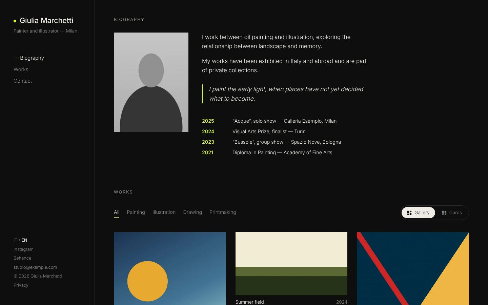
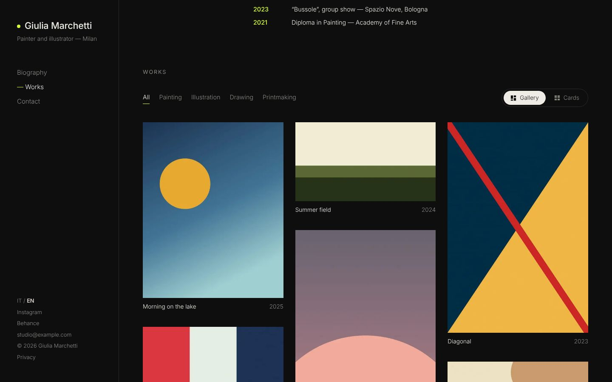
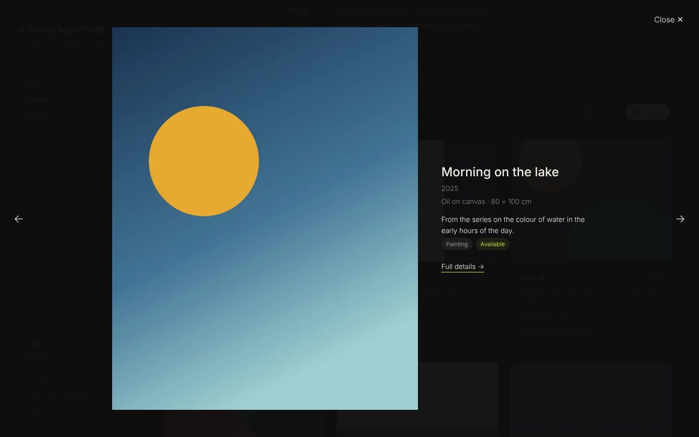
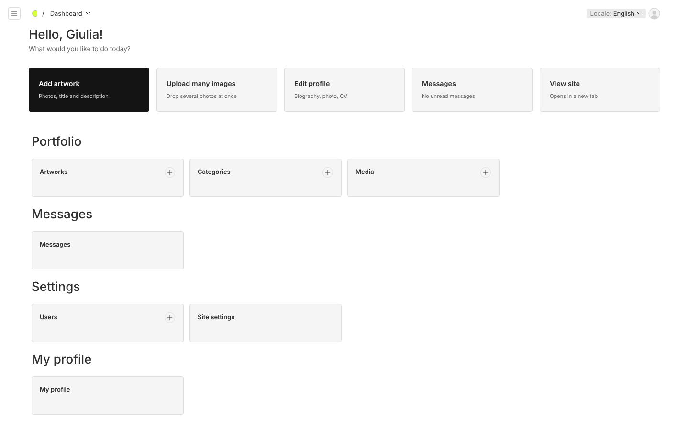
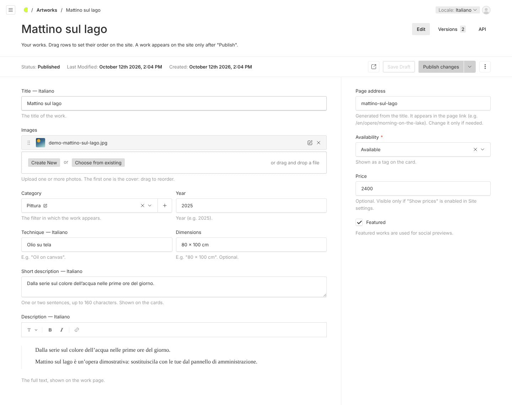
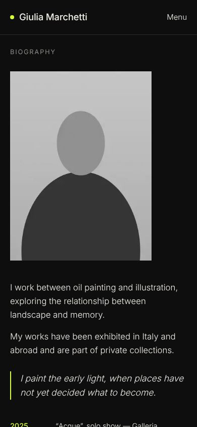

# Portfolio Artist

**English** · [Italiano](README.it.md)

A **generic, customizable** portfolio website for professional artists, with a **simple admin panel** where the artist manages biography, artworks, categories and messages without any technical skills. One installation = one artist, shipped with **Docker**.



| Gallery | Cards | Lightbox |
|---|---|---|
|  |  |  |

| Admin: welcome | Admin: editing an artwork | Mobile |
|---|---|---|
|  |  |  |

## Features

- **One-page site** (Biography → Works → Contact) with the *Atelier Notturno* theme: fixed sidebar, category filters, Gallery or Cards view, lightbox with keyboard and swipe, a dedicated page for every artwork.
- **Italian and English**: content translatable from the admin, `/it/…` and `/en/…` URLs, language picked from the browser.
- **Admin panel** (Payload CMS at `/admin`, in Italian or English following the browser): big buttons for frequent tasks, multi-image upload, drag & drop ordering, drafts and preview, contact form messages.
- **Customization** from *Site settings*: accent color, fonts, logo, icon, default works view, prices, contact form, SEO texts, privacy policy, cookie-less analytics (Plausible/Umami).
- **SEO**: per-page metadata and Open Graph, `hreflang`, multilingual sitemap, `robots.txt`, `Person` and `VisualArtwork` structured data. Lighthouse mobile ≥ 95 in every category with the demo data.
- **Production**: non-root standalone Docker image, automatic database migrations at startup, daily backups of database and images, security headers. TLS stays with your reverse proxy.

## Quick start (development)

You need Node 24, pnpm (via `corepack enable`) and Docker (or a local PostgreSQL).

```bash
git clone https://github.com/Ruy41321/portfolio-artist.git
cd portfolio-artist
pnpm install
cp .env.example .env        # set PAYLOAD_SECRET (openssl rand -hex 32)
./scripts/dev-db.sh         # starts PostgreSQL and creates the portfolio and portfolio_test databases
pnpm seed                   # migrations + demo data (set SEED_ADMIN_EMAIL/PASSWORD for a demo user)
pnpm dev                    # http://localhost:3000 and http://localhost:3000/admin
```

Without `SEED_ADMIN_*` the first visit to `/admin` asks you to create the user.

**On Windows** use PowerShell (you need Docker Desktop and Node 24; run `corepack enable` once in an administrator PowerShell, or `npm install -g pnpm@10`). Use `Copy-Item .env.example .env` instead of `cp` and `docker compose up -d postgres` instead of `./scripts/dev-db.sh`: on first start it creates both `portfolio` and `portfolio_test`. The `.sh` scripts (setup, backup, restore) need Git Bash or WSL.

Checks:

```bash
pnpm lint && pnpm typecheck && pnpm test   # unit + integration (test database)
pnpm test:e2e                              # Playwright against a production build
```

## Deploy in 5 steps

On a server with Docker and a reverse proxy handling HTTPS (details and examples in [docs/en/DEPLOY.md](docs/en/DEPLOY.md)):

1. Copy `compose.prod.yml`, the `docker/backup/` folder and the `scripts/` folder to the server (or clone the repository).
2. Generate the configuration: `./scripts/setup.sh` (asks for the public address and the local port, creates `.env` with random secrets).
3. Start: `docker compose -f compose.prod.yml up -d` (uses the `ghcr.io/ruy41321/portfolio-artist` image, published to GitHub Container Registry on every `v*` tag; add `--build` to build it from source).
4. Point your reverse proxy to `http://127.0.0.1:APP_PORT` (nginx, Caddy and Traefik examples in DEPLOY.md).
5. Open `https://your-domain/admin`, create the artist's user and hand over the [artist guide](docs/en/ARTIST-GUIDE.md).

## Configuration

Every variable is documented in [`.env.example`](.env.example). The main ones:

| Variable | Description |
|---|---|
| `NEXT_PUBLIC_SERVER_URL` | Public address of the site, no trailing `/` (absolute URLs, sitemap, Open Graph, CSRF). Read at startup: the same image works for any domain. |
| `PAYLOAD_SECRET` | Long random secret for sessions. |
| `DATABASE_URL` / `POSTGRES_*` | PostgreSQL connection (in production built from `POSTGRES_*`). |
| `APP_PORT`, `APP_BIND` | Port and interface the app listens on (default `127.0.0.1:3000`). |
| `MAX_UPLOAD_MB` | Maximum size of uploaded files. |
| `SMTP_*`, `CONTACT_EMAIL_TO` | Optional email for the contact form; without SMTP messages stay in the admin. |
| `BACKUP_INTERVAL_HOURS`, `BACKUP_RETENTION_DAYS`, `BACKUP_DIR` | Backup frequency, retention and folder. |

## Updating

```bash
docker compose -f compose.prod.yml pull
docker compose -f compose.prod.yml up -d
```

Database migrations run automatically at startup. Take a backup before updating: `./scripts/backup.sh`.

## Documentation

- [docs/en/DEPLOY.md](docs/en/DEPLOY.md) — server installation, reverse proxy, Aruba, backup and restore, troubleshooting
- [docs/en/ARTIST-GUIDE.md](docs/en/ARTIST-GUIDE.md) — admin guide for the artist
- [docs/en/CUSTOMIZATION.md](docs/en/CUSTOMIZATION.md) — new themes, new fields, new languages
- [CHANGELOG.md](CHANGELOG.md)
- Development plan and log (Italian): [docs/PLAN.md](docs/PLAN.md), [docs/PROGRESS.md](docs/PROGRESS.md)

The original layout drafts are in [`design/drafts/`](design/drafts/) (`python -m http.server 5500 --directory design/drafts`).

## Stack

Next.js 16 (App Router) · Payload CMS 3 · PostgreSQL 17 · TypeScript strict · pnpm · Node 24 · Docker Compose · Vitest · Playwright · GitHub Actions
