# Guida per l'artista

Questa guida spiega come aggiornare il tuo sito dal **pannello di amministrazione**. Non serve nessuna competenza tecnica: tutto si fa dal browser, e ogni modifica salvata compare subito sul sito.

> Il pannello si apre aggiungendo `/admin` all'indirizzo del sito, per esempio `https://www.tuosito.it/admin`.

---

## 1. Primo accesso

La prima volta il pannello ti chiede di **creare il tuo utente**: scrivi la tua email e una password (lunga, almeno 12 caratteri) e premi *Crea*. Dalle volte successive entri con la pagina di accesso:

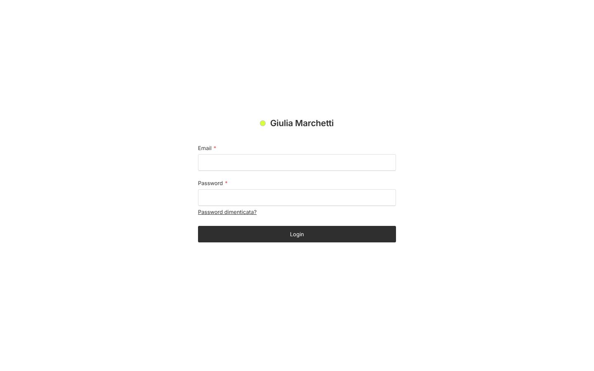

Se dimentichi la password usa *Password dimenticata?* (funziona se è stata configurata l'email) oppure chiedi a chi ha installato il sito.

Dopo l'accesso vedi la pagina di benvenuto con le azioni più frequenti:

- **Aggiungi opera** — inserisci una nuova opera.
- **Carica più immagini** — carica tante foto insieme.
- **Modifica profilo** — biografia, foto, curriculum, contatti.
- **Messaggi** — i messaggi arrivati dal sito, con il numero di quelli da leggere.
- **Vedi il sito** — apre il sito in una nuova scheda.

Sotto i pulsanti possono comparire degli avvisi gialli (per esempio opere senza categoria o bozze non pubblicate) con il link per sistemarli.

## 2. Il tuo profilo

Apri **Il mio profilo**. I campi sono divisi in tre schede:

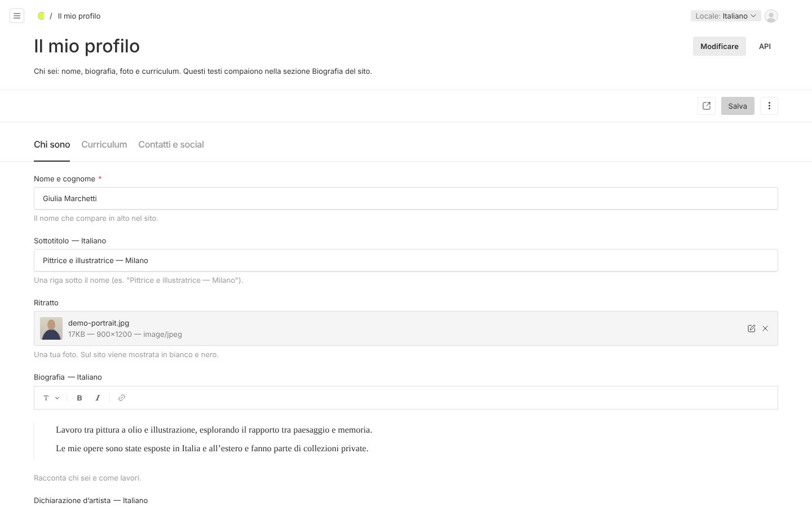

- **Chi sono**: nome e cognome (compare in alto nel sito), sottotitolo (es. *Pittrice e illustratrice — Milano*), ritratto (sul sito diventa in bianco e nero), biografia, una frase sulla tua poetica e la città.
- **Curriculum**: premi *Aggiungi Voce* per ogni mostra, premio o studio. Scrivi l'anno, scegli il tipo e la descrizione. Trascina le righe per ordinarle. Puoi anche caricare il CV in PDF: sul sito comparirà *Scarica il CV*.
- **Contatti e social**: l'email pubblica, il testo della sezione Contatti e i tuoi profili social (scegli la piattaforma e incolla il link completo che inizia con `https://`).

Premi **Salva** in alto a destra. Il pulsante *Anteprima* (l'icona con la freccia) apre il sito per controllare il risultato.

## 3. Aggiungere un'opera

Premi **Aggiungi opera**:

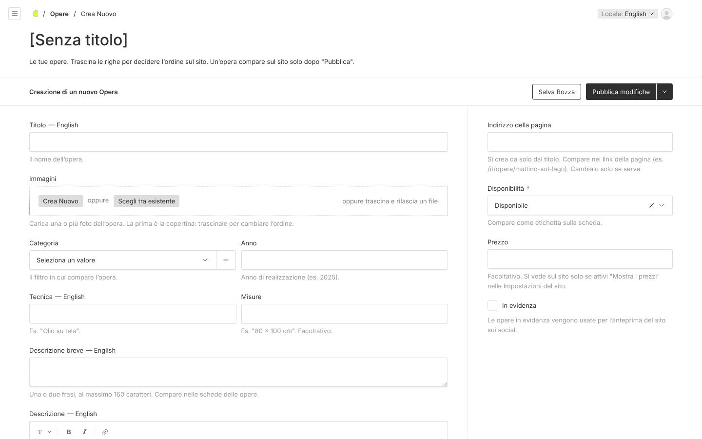

1. **Titolo** dell'opera.
2. **Immagini**: premi *Crea Nuovo* e poi *Seleziona un file* (o trascina le foto nel riquadro). Puoi scegliere più foto insieme:

   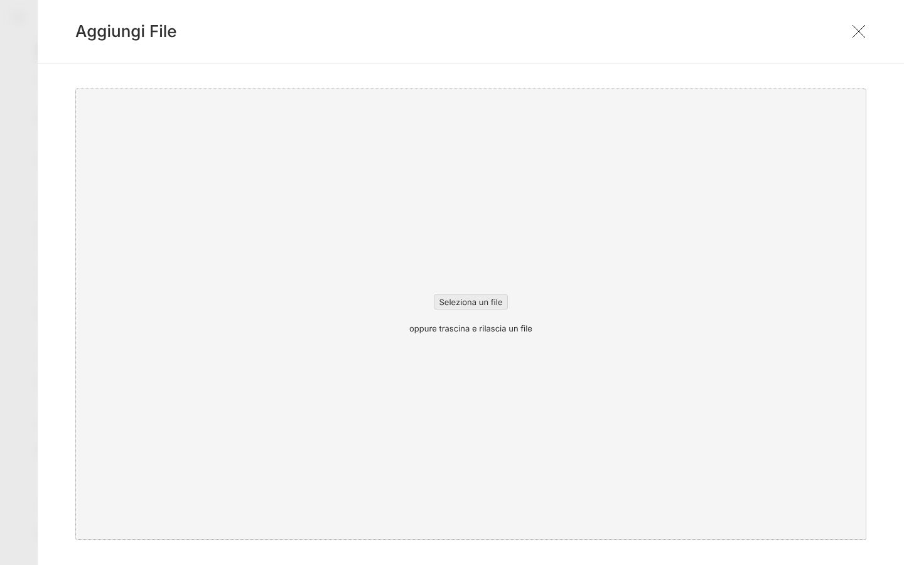

   Per ogni foto scrivi una breve **descrizione dell'immagine** (cosa si vede: serve a chi non vede e a Google), poi premi *Salva*. La **prima immagine è la copertina**: trascina le immagini per cambiarne l'ordine. Con *Scegli tra esistente* usi foto già caricate.
3. **Categoria** (es. Pittura): decide in quale filtro compare l'opera.
4. **Anno**, **Tecnica** (es. *Olio su tela*) e **Misure** (es. *80 × 100 cm*).
5. **Descrizione breve**: una o due frasi (massimo 160 caratteri), compare nelle schede.
6. **Descrizione**: il testo completo, visibile nella pagina dell'opera. Puoi usare grassetto, corsivo, titoli, elenchi e link.
7. Nella colonna a destra: **Disponibilità** (Disponibile, Venduta, Collezione privata, Non in vendita), **Prezzo** (facoltativo) e **In evidenza** (le opere in evidenza vengono usate come anteprima quando qualcuno condivide il sito).

Infine:

- **Salva Bozza** — l'opera resta privata, puoi finirla dopo.
- **Pubblica modifiche** — l'opera compare subito sul sito.

L'**indirizzo della pagina** (es. `/it/opere/mattino-sul-lago`) si crea da solo dal titolo: non serve toccarlo.

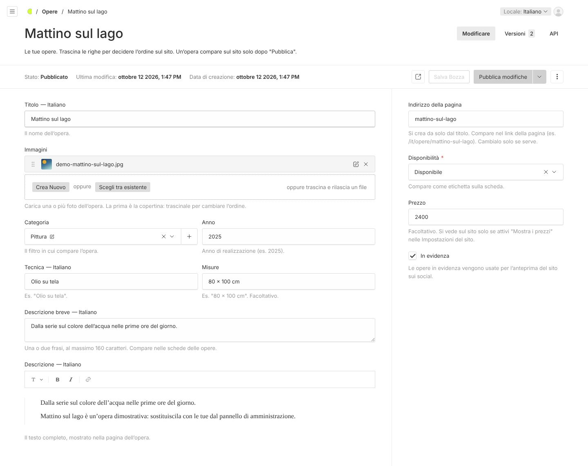

**Scorciatoia.** In *Immagini e file* puoi caricare molte foto con *Caricamento in Blocco*; poi apri una foto e premi **Crea un'opera da questa immagine**: si apre una bozza con la foto già inserita.

### Modificare, nascondere o eliminare un'opera

Apri **Opere**, clicca sul titolo, cambia quello che serve e premi *Pubblica modifiche*. Per toglierla dal sito senza cancellarla usa la freccia accanto a *Pubblica modifiche* → *Annulla pubblicazione*. Per eliminarla definitivamente usa i tre puntini in alto a destra → *Elimina*.

## 4. Ordinare le opere

Nella lista **Opere** trascina le righe dalla maniglia `⠿` a sinistra: l'ordine della lista è l'ordine sul sito.

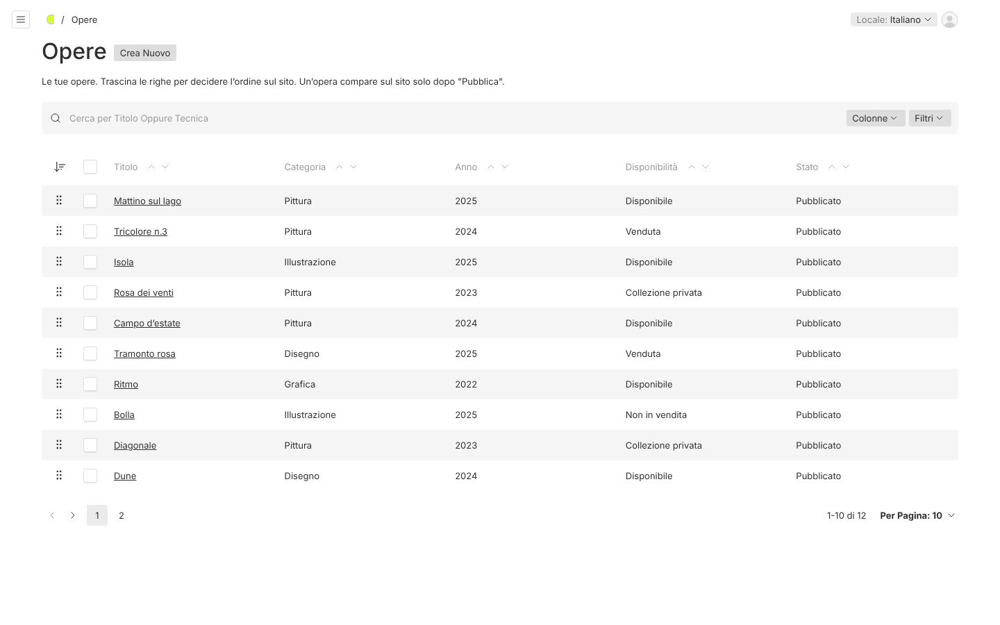

## 5. Categorie (i filtri del sito)

Le categorie sono i filtri sopra le opere (*Tutti*, *Pittura*, *Disegno*…). Le gestisci da **Categorie**:

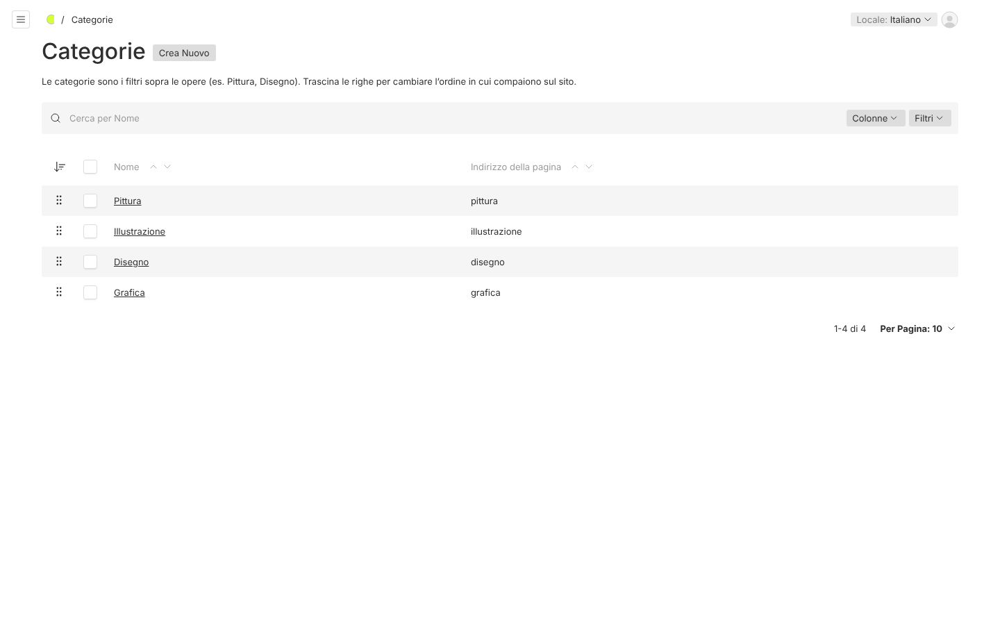

- **Aggiungere**: *Crea Nuovo*, scrivi il nome, *Salva*.
- **Rinominare**: apri la categoria, cambia il nome, *Salva*. Il filtro sul sito si aggiorna subito.
- **Ordinare**: trascina le righe; i filtri seguono lo stesso ordine.
- **Eliminare**: apri la categoria, tre puntini → *Elimina*. Un riquadro ti dice quante opere la usano. Le opere **non** vengono cancellate: restano senza categoria, sul sito compaiono solo in *Tutti* e la pagina di benvenuto ti ricorda di assegnarne una nuova.

Una categoria senza opere pubblicate non compare tra i filtri.

## 6. Traduzioni in inglese

Il sito è in italiano e in inglese. I campi con la scritta **— Italiano** accanto al nome si traducono:

1. In alto a destra premi **Locale: Italiano** e scegli **English**.
2. Scrivi i testi in inglese negli stessi campi e premi *Pubblica modifiche* (o *Salva*).

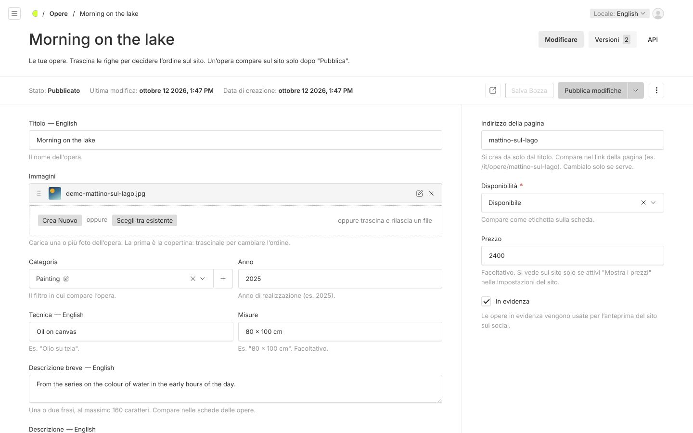

Se un testo inglese manca, il sito in inglese mostra quello italiano. Immagini, anni, misure e prezzi sono condivisi tra le due lingue.

## 7. Impostazioni del sito

In **Impostazioni del sito** trovi quattro schede:

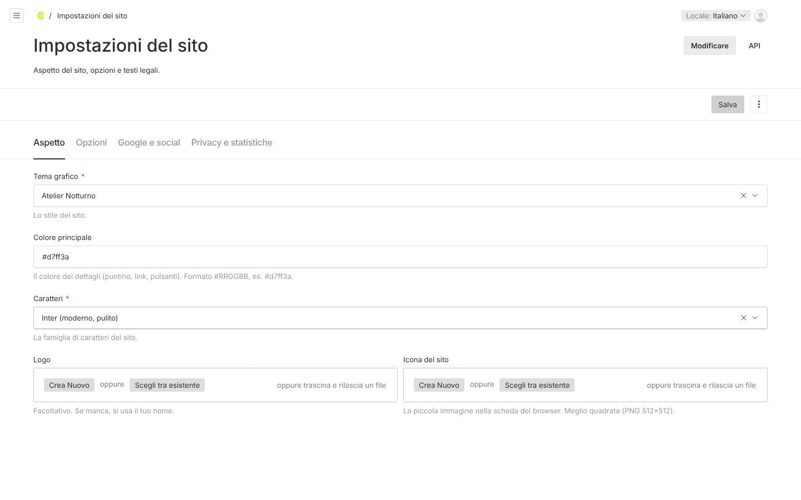

- **Aspetto**: tema, **colore principale** (formato `#RRGGBB`, es. `#d7ff3a`), caratteri, logo e icona del sito.
- **Opzioni**: vista predefinita delle opere (Galleria o Schede: i visitatori possono cambiarla), **Mostra i prezzi** (solo per le opere disponibili con un prezzo) e valuta, attivazione del modulo contatti.
- **Google e social**: titolo e descrizione del sito per i motori di ricerca, immagine per le condivisioni.
- **Privacy e statistiche**: testo della pagina Privacy e statistiche delle visite facoltative (solo servizi senza cookie, come Plausible o Umami).

## 8. Messaggi

I messaggi inviati dal modulo **Contatti** del sito arrivano in **Messaggi** (e anche via email, se è stata configurata).

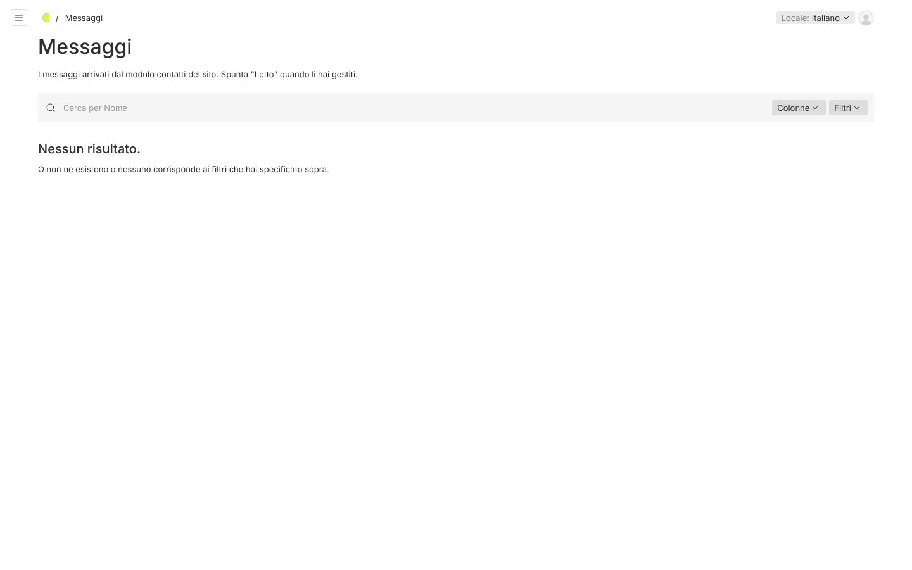

Apri un messaggio per leggerlo, rispondi all'indirizzo email indicato e spunta **Letto**. La pagina di benvenuto mostra quanti messaggi restano da leggere.

## 9. Immagini e file

In **Immagini e file** trovi tutto quello che hai caricato:

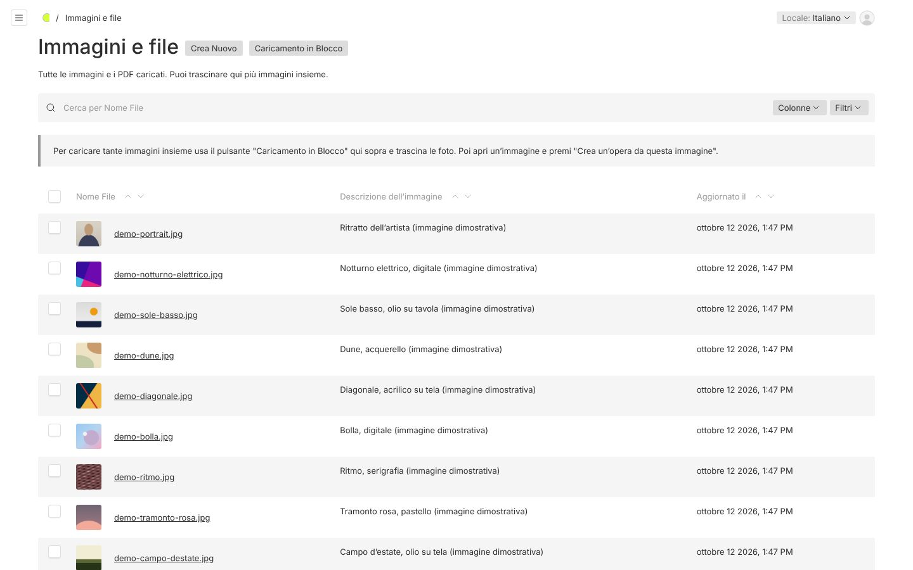

- **Caricamento in Blocco** per caricare tante foto insieme.
- Aprendo un'immagine puoi cambiare la descrizione, ritagliarla (*Modifica immagine*) o scegliere il **punto focale**, cioè la parte che deve restare visibile quando la foto viene tagliata nelle schede.
- Formati accettati: JPG, PNG, WebP, AVIF e PDF (per il CV). Le immagini vengono ridimensionate automaticamente: carica foto di buona qualità (almeno 2000 pixel sul lato lungo).

## Consigli

- Scrivi sempre la descrizione delle immagini: migliora l'accessibilità e la posizione su Google.
- Usa *Salva Bozza* per lavorare con calma e *Anteprima* per controllare prima di pubblicare.
- Se qualcosa non va come previsto, chiedi a chi ha installato il sito: ogni giorno viene fatto un backup automatico di testi e immagini.
