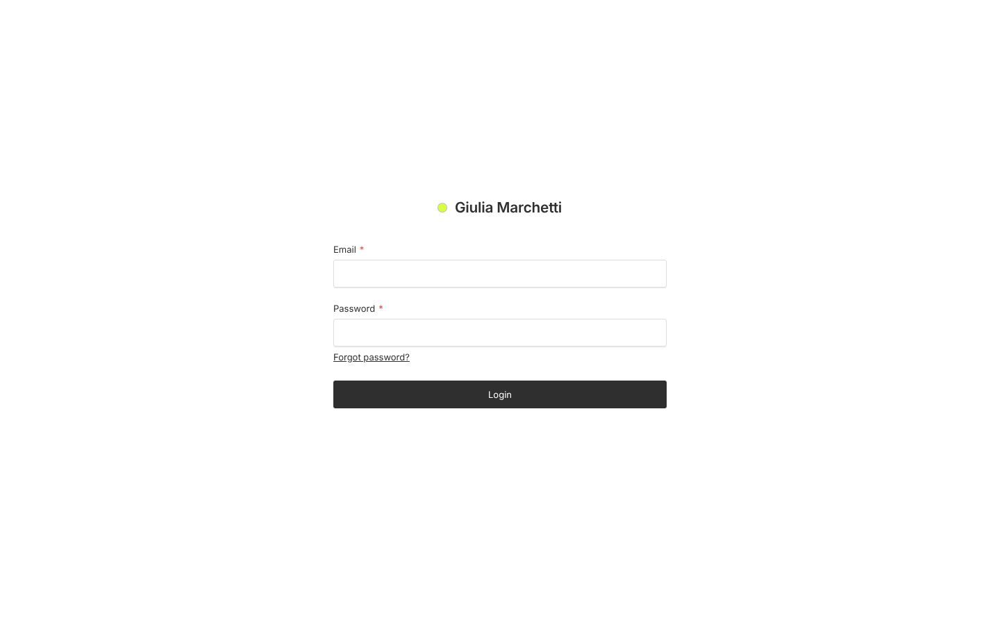
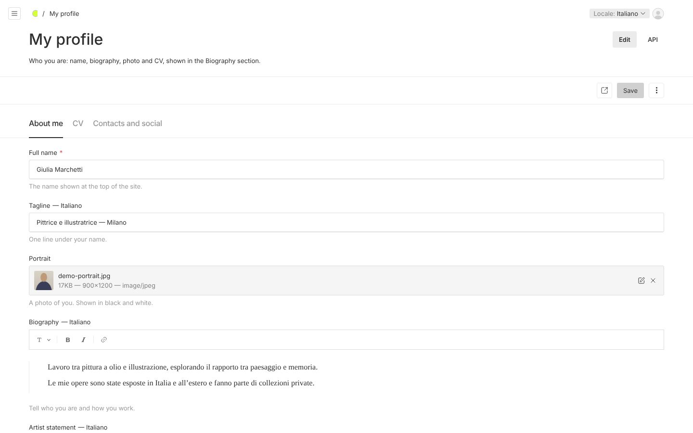
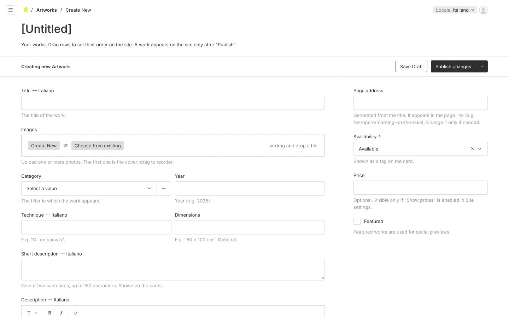
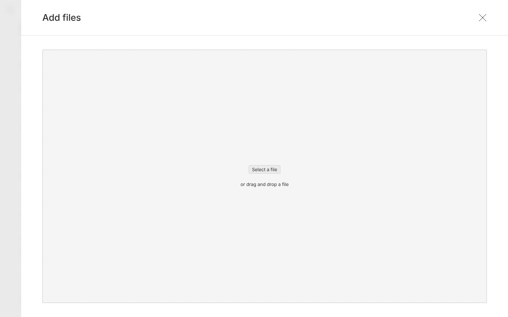
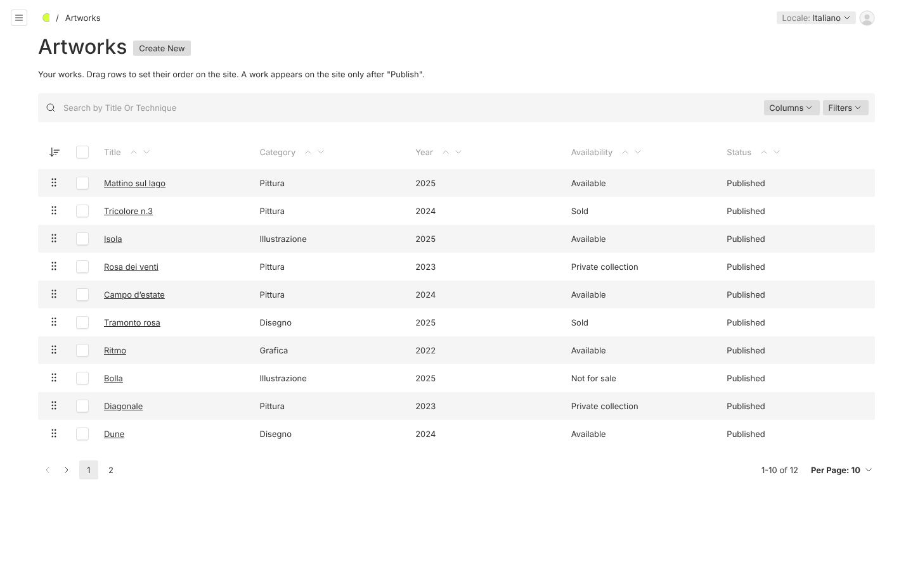
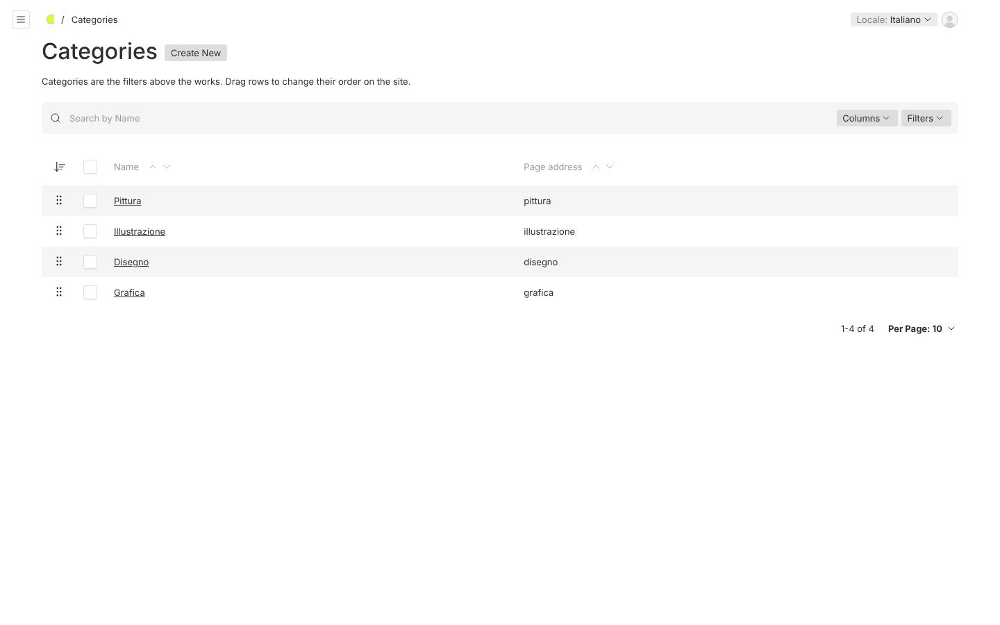
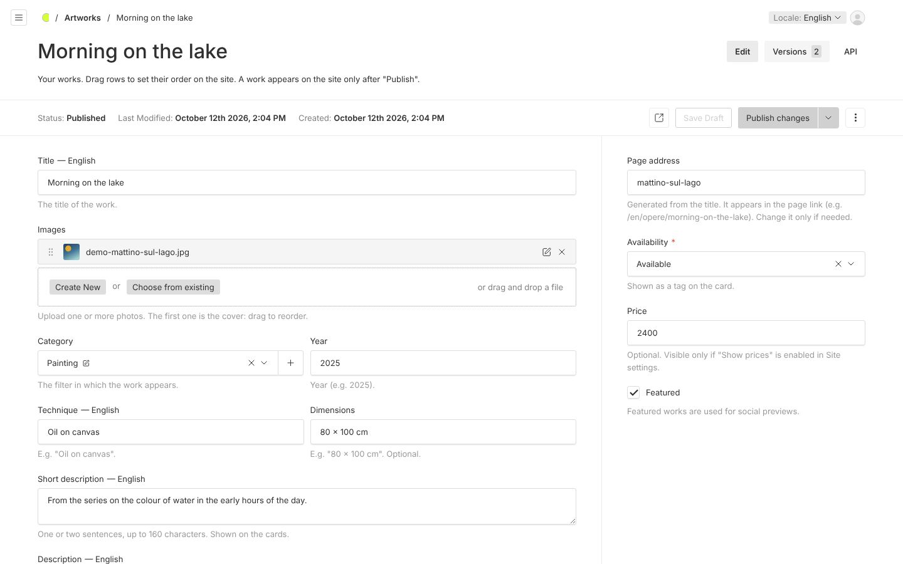
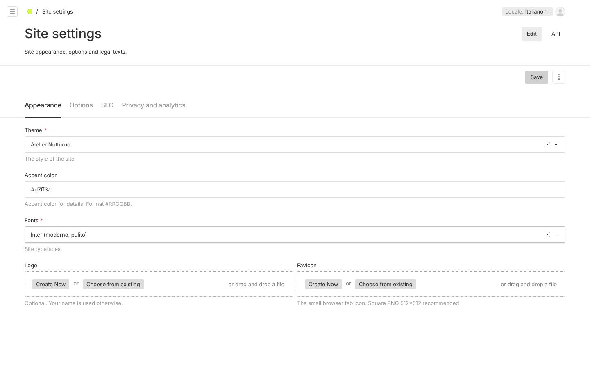
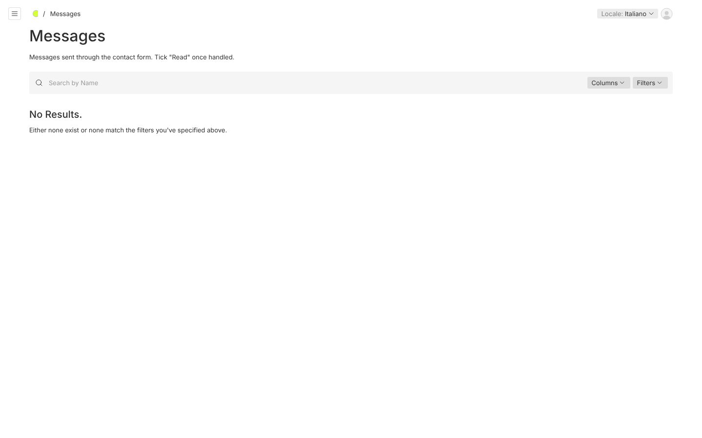
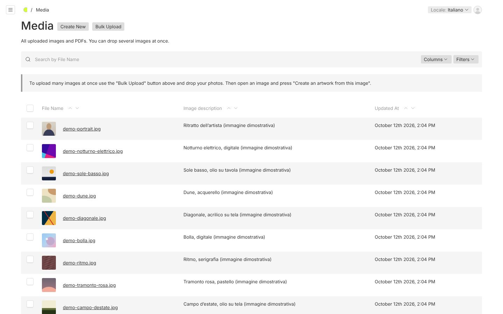

# Artist guide

**English** · [Italiano](../it/GUIDA-ARTISTA.md)

This guide explains how to update your website from the **admin panel**. No technical skills are needed: everything happens in the browser, and every change you save shows up on the site immediately.

> The admin panel opens by adding `/admin` to the site address, for example `https://www.yoursite.com/admin`.
>
> The panel speaks the language of your browser (English or Italian). You can change it from your account (the round icon at the top right). The screenshots below show the English panel.

---

## 1. First access

The first time, the panel asks you to **create your user**: enter your email and a password (long, at least 12 characters) and press *Create*. From then on you sign in from the login page:

If you forget your password use *Forgot password?* (it works if email has been configured) or ask whoever installed the site.

After signing in you see the welcome page with the most frequent actions:

- **Add artwork** — add a new artwork.
- **Upload many images** — upload many photos at once.
- **Edit profile** — biography, photo, CV, contacts.
- **Messages** — the messages sent from the site, with the number still to read.
- **View site** — opens the site in a new tab.

Below the buttons yellow notices may appear (for example artworks without a category or unpublished drafts) with a link to fix them.

## 2. Your profile

Open **My profile**. The fields are split into three tabs:

- **About me**: full name (shown at the top of the site), tagline (e.g. *Painter and illustrator — Milan*), portrait (shown in black and white on the site), biography, a short artist statement and your city.
- **CV**: press *Add Entry* for each exhibition, award or course. Enter the year, choose the type and write the description. Drag the rows to reorder them. You can also upload your CV as a PDF: a *Download CV* link will appear on the site.
- **Contacts and social**: the public email, the text of the Contact section and your social profiles (choose the platform and paste the full link starting with `https://`).

Press **Save** at the top right. The *Preview* button (the icon with the arrow) opens the site so you can check the result.

> **Language of the content.** Fields marked **— Italiano** next to their name are translatable. Italian is the main language of the site: write the texts in Italian first, then add the English translation (see section 6).

## 3. Adding an artwork

Press **Add artwork**:

1. **Title** of the artwork.
2. **Images**: press *Create New* and then *Select a file* (or drop the photos into the box). You can choose several photos at once:

   

   For each photo write a short **image description** (what it shows: it helps people who cannot see images and Google), then press *Save*. The **first image is the cover**: drag the images to change their order. With *Choose from existing* you use photos you already uploaded.
3. **Category** (e.g. Painting): decides in which filter the artwork appears.
4. **Year**, **Technique** (e.g. *Oil on canvas*) and **Dimensions** (e.g. *80 × 100 cm*).
5. **Short description**: one or two sentences (at most 160 characters), shown on the cards.
6. **Description**: the full text, shown on the artwork page. You can use bold, italic, headings, lists and links.
7. In the right column: **Availability** (Available, Sold, Private collection, Not for sale), **Price** (optional) and **Featured** (featured works are used as the preview when someone shares the site).

Finally:

- **Save Draft** — the artwork stays private, you can finish it later.
- **Publish changes** — the artwork appears on the site immediately.

The **page address** (e.g. `/en/opere/mattino-sul-lago`) is created automatically from the Italian title: you do not need to touch it.

**Shortcut.** In *Media* you can upload many photos with *Bulk Upload*; then open a photo and press **Create an artwork from this image**: a draft opens with the photo already in place.

### Editing, hiding or deleting an artwork

Open **Artworks**, click the title, change what you need and press *Publish changes*. To remove it from the site without deleting it use the arrow next to *Publish changes* → *Unpublish*. To delete it for good use the three dots at the top right → *Delete*.

## 4. Ordering the artworks

In the **Artworks** list drag the rows by the `⠿` handle on the left: the order of the list is the order on the site.

## 5. Categories (the site filters)

Categories are the filters above the works (*All*, *Painting*, *Drawing*…). Manage them from **Categories**:

- **Add**: *Create New*, type the name, *Save*.
- **Rename**: open the category, change the name, *Save*. The filter on the site updates immediately.
- **Order**: drag the rows; the filters follow the same order.
- **Delete**: open the category, three dots → *Delete*. A box tells you how many artworks use it. The artworks are **not** deleted: they stay without a category, appear only under *All* on the site, and the welcome page reminds you to assign a new one.

A category without published artworks does not appear among the filters.

## 6. English translations

The site is in Italian and English. Fields with **— Italiano** next to their name can be translated:

1. At the top right press **Locale: Italiano** and choose **English**.
2. Write the English texts in the same fields and press *Publish changes* (or *Save*).

If an English text is missing, the English site shows the Italian one. Images, years, dimensions and prices are shared by both languages.

## 7. Site settings

**Site settings** has four tabs:

- **Appearance**: theme, **accent color** (`#RRGGBB` format, e.g. `#d7ff3a`), fonts, logo and site icon.
- **Options**: default works view (Gallery or Cards: visitors can switch), **Show prices** (only for available works with a price) and currency, enabling the contact form.
- **SEO**: site title and description for search engines, image for social sharing.
- **Privacy and analytics**: text of the Privacy page and optional visit statistics (only cookie-less services such as Plausible or Umami).

## 8. Messages

Messages sent from the site's **Contact** form arrive in **Messages** (and by email too, if it has been configured).

Open a message to read it, reply to the email address shown and tick **Read**. The welcome page shows how many messages are still unread.

## 9. Images and files

**Media** contains everything you uploaded:

- **Bulk Upload** to upload many photos at once.
- When you open an image you can change its description, crop it (*Edit Image*) or choose the **focal point**, i.e. the part that must stay visible when the photo is cropped in the cards.
- Accepted formats: JPG, PNG, WebP, AVIF and PDF (for the CV). Images are resized automatically: upload good quality photos (at least 2000 pixels on the long side).

## Tips

- Always write the image descriptions: they improve accessibility and your ranking on Google.
- Use *Save Draft* to work calmly and *Preview* to check before publishing.
- If something does not work as expected, ask whoever installed the site: texts and images are backed up automatically every day.
